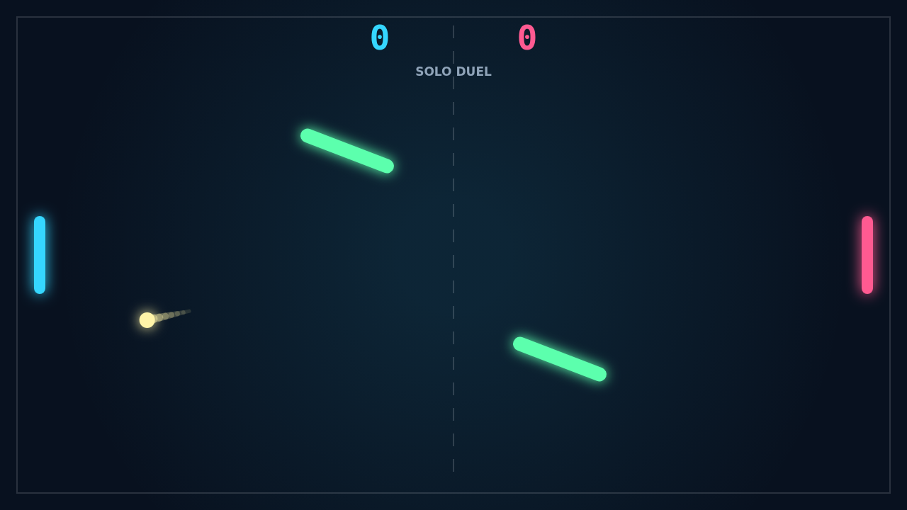

# Carom

Carom is a fast paddle duel where every return can become a trick shot. You meet
the ball cleanly, move through the hit, and watch the added spin bend its path
after it leaves your paddle.

The middle of the field is never empty. Two bright bars sway and rotate through
the arena, turning simple volleys into bank-shot puzzles where a safe line one
second becomes a dangerous ricochet the next.

Solo play gives you a sharp AI defender to break down; Versus turns the same
field into a shared-keyboard duel. Matches run to 11, win by 2, so late points
can stretch into tense rallies where one curved return changes everything.
